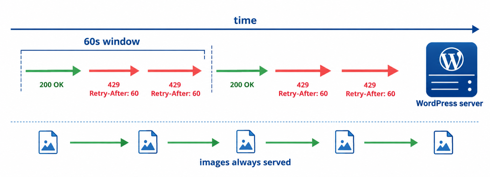

# Facebook Request Throttle

[](https://www.php.net/)
[](https://wordpress.org/)
[](https://github.com/nadimtuhin/Facebook-Request-Throttle-WordPress-Plugin/actions/workflows/ci.yml)
[](./LICENSE)
[](./CHANGELOG.md)


A WordPress plugin that rate-limits Facebook's link-preview crawlers.

When a URL is shared on Facebook, `facebookexternalhit` and `meta-externalagent` can request it dozens of times in a few seconds, and a viral post can keep that going for hours. This plugin lets one crawler request through per window (60 seconds by default) and answers the rest with `429 Too Many Requests` and a `Retry-After` header. Regular visitors never touch the throttle.

## Requirements

| | Minimum | Tested |
|---|---|---|
| PHP | 7.4 | 8.1, 8.2, 8.3 (CI) |
| WordPress | 5.0 | 6.9 |

The test suite needs PHP 8.1+ because of PHPUnit 10. The plugin itself runs on 7.4.

## What it does

- Matches `facebookexternalhit` and `meta-externalagent` in the User-Agent, case-insensitively.
- Gives each crawler its own throttle clock, so a burst from one doesn't block the other.
- Returns `429` with `Retry-After` set to the configured window.
- Lets image requests (jpg, jpeg, png, gif, webp) through, so Open Graph previews still render.
- Logs the last 100 throttled requests (time, IP, URI, user agent) under **Settings → FB Throttle Log** and counts allowed hits.
- Adds `wp fb-throttle` WP-CLI commands.
- Updates from GitHub releases: minor versions auto-install, major versions wait for you to click Update.
- Removes its options and transients on uninstall, on every site of a multisite network.

## How it works



```
request
  │
  ├─ User-Agent isn't a Facebook crawler ────────► pass through
  ├─ image file (jpg/png/gif/webp) ──────────────► pass through
  ├─ crawler's slot free for this window ────────► 200, start the window
  └─ slot already taken ─────────────────────────► 429 + Retry-After
```

With a persistent object cache (Redis, Memcached) the slot is claimed with an atomic `wp_cache_add`. Without one, the plugin falls back to a database transient.

## Installation

1. Download the [latest release](https://github.com/nadimtuhin/Facebook-Request-Throttle-WordPress-Plugin/releases/latest) and unzip it into `wp-content/plugins/`, or clone the repo there.
2. Activate it under **Plugins → Installed Plugins**.
3. Optional: change the window under **Settings → FB Throttle Log**.

## Configuration

The default window is 60 seconds. Set it in any of these, highest priority first:

1. **Dashboard:** Settings → FB Throttle Log. Accepts 1 to 86400 seconds and applies to the next request.
2. **WP-CLI:** `wp fb-throttle duration 120` writes the same option as the dashboard.
3. **wp-config.php:**

   ```php
   define( 'NT_FACEBOOK_REQUEST_THROTTLE', 120 );
   ```

   The older `FACEBOOK_REQUEST_THROTTLE` name still works.

To throttle other crawlers, add User-Agent substrings to `$nt_user_agents_to_throttle` in `facebook-request-throttle.php`.

## WP-CLI

```bash
wp fb-throttle status                         # window, allowed/throttled counts, last throttled hit
wp fb-throttle log --limit=50 --format=json   # throttled-hit log
wp fb-throttle clear                          # reset the log and the counter
wp fb-throttle duration [<seconds>]           # read or set the window
```

## Limitations

- **User agents can be spoofed.** A fake `facebookexternalhit` request uses the real crawler's slot and can push it into 429s. Facebook crawls from many IPs, so per-IP buckets would defeat the point. Block abusive IPs at the firewall.
- **Without a persistent object cache** the database path is read-then-write, so truly concurrent hits can let one extra request through per window.
- **With several web servers** each node keeps its own clock unless they share an object cache.

## Trying it against a site

`testbot` sends five requests per crawler User-Agent, one second apart:

```bash
./testbot https://example.com
TESTBOT_URL=https://example.com ./testbot
```

On a fresh 60-second window, expect one `200` and then four `429`s for each User-Agent.

## Development

```bash
composer install
composer test          # PHPUnit
vendor/bin/phpcs       # WordPress coding standards
```

CI runs both on PHP 8.1, 8.2 and 8.3. Release steps are in [CONTRIBUTING.md](CONTRIBUTING.md), version history in [CHANGELOG.md](CHANGELOG.md).

## License

GPL-2.0-or-later. See [LICENSE](LICENSE).
